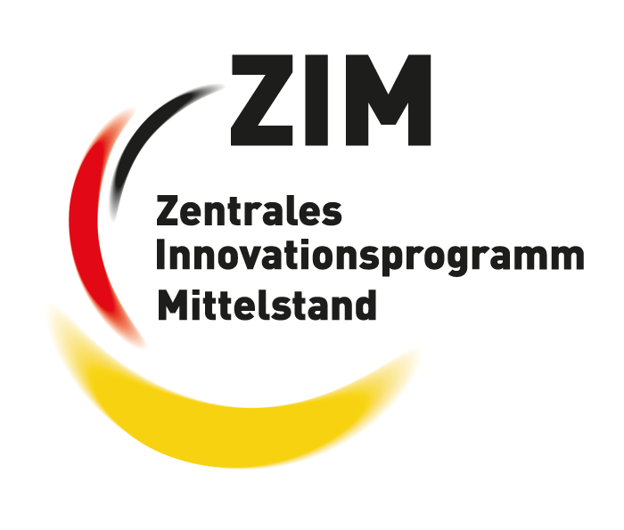

# ARiadne

ARiadne is an open-source augmented reality (AR) SDK for precise pedestrian navigation.
Instead of a map that leaves you guessing which way to go, ARiadne places the route directly into the camera image,
so you know where to walk from the very first step.

It is developed by [SWCode](https://swcode.io) together with the
[Immersive Reality Lab](https://immersive-reality-lab.de/) of the
[Hamm-Lippstadt University of Applied Sciences (HSHL)](https://www.hshl.de/),
which researches the usability of the navigation concepts in user studies.

## Features

- AR route guidance on the camera image (ViroReact with ARCore), with floor arrows and an animated guide dog
- Positioning that fuses ARCore Geospatial (VPS), GPS and compass into one estimate
- Routing with GraphHopper, address search with Photon, GraphHopper or Google
- Points of interest from OpenStreetMap, enriched with annotations maintained in the ARiadne CMS
- On-device object detection (ONNX) of street furniture and traffic
- Warnings before stepping onto streets, and audio cues
- English and German user interface

## Repository structure

| Folder         | Content                                                                                             |
| -------------- | --------------------------------------------------------------------------------------------------- |
| [`sdk/`](sdk/) | The ARiadne SDK and the demo app (React Native, Expo) for Android and iOS                           |
| [`cms/`](cms/) | The editor CMS for annotations on OpenStreetMap places (Node.js, Hono, PostgreSQL, React)           |

See [`sdk/README.md`](sdk/README.md) and [`cms/README.md`](cms/README.md) to build and run them.
The app needs a physical AR-capable device and API keys for MapTiler, GraphHopper and ARCore Geospatial.
The guide dog model and the sound effects are not included; [`sdk/assets/3d/dog/`](sdk/assets/3d/dog/README.md) and
[`sdk/assets/3d/sounds/`](sdk/assets/3d/sounds/README.md) describe how to add them before building the app.

The GitHub workflows only build and test the code; they do not deploy anything.

## Funding

ARiadne is funded by the [Zentrales Innovationsprogramm Mittelstand (ZIM)](https://www.zim.de).
ZIM is the funding programme of the German Federal Ministry for Economic Affairs and Energy (BMWE)
for research and development projects of small and medium-sized enterprises and the research institutions working with them.

## License

The source code is licensed under the [MIT License](LICENSE).
The object detection model `sdk/assets/models/poi-detector.onnx` is exported from Ultralytics YOLOE
and keeps its own license (AGPL-3.0).
